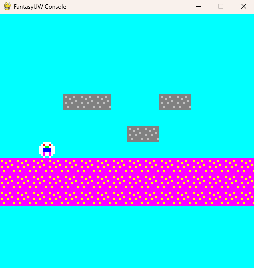

# FantasyUW: a fantasy console on the Ultima Underworld VM



FantasyUW turns the Ultima Underworld conversation VM into a small game console: a 128×128 screen with 16 colors, a pixel font, sprites, sound and keyboard input. Programs are written in [UWScript](../uwscript/README.md), the same language used for UW conversations. The console adds its functions as extra imported functions (`CALLI` 100 and up), so the language and the VM stay the same as for the game.

```uwscript
let x = 64
label frame
    clear_screen(12)
    if is_key_pressed(2)
        x -= 1
    endif
    if is_key_pressed(3)
        x += 1
    endif
    fill_circle(x, 64, 6, 5)
    print(2, 2, "X = " + x, 1)
    flip_display()
    if not is_key_pressed(6)
        goto frame
    endif
```

## Installation

```bash
pip install -r requirements.txt     # pygame
```

The console imports the VM (`uwscript_vm.py`) and the compiler (`uwscript_compiler.py`) from [`../uwscript`](../uwscript/README.md), so keep the two folders side by side.

## Running programs

```bash
python fantasy_console.py samples/fantasy_pong.uws              # compile and run
python fantasy_console.py samples/fantasy_pong.asm              # run compiled assembly (+ fantasy_pong_strings.txt)
python fantasy_console.py samples/fantasy_text_and_shapes.uws --scale 6 --fps 60
```

To compile a console program yourself, use the `console` target. The default target, `uw`, refuses console functions, because the game does not have them:

```bash
python ../uwscript/uwscript_compiler.py --target console samples/fantasy_pong.uws
```

On Windows, `start.bat samples\fantasy_pong.uws` compiles and runs a program. `standalone_jumprun.py` is a self-contained example with an embedded game.

| Option | Default | Meaning |
|--------|---------|---------|
| `--strings FILE` | `<program>_strings.txt` | string block for `.asm` programs |
| `--scale N` | 4 | window pixels per console pixel |
| `--fps N` | 30 | target frames per second |
| `--steps N` | 20000 | instructions per frame before the frame is cut short |
| `--headless` | | run without a window and sound (for tests and screenshots) |
| `--frames N` | | stop after N frames |
| `--screenshot FILE` | | save the last frame (128×128) as an image, e.g. `out.png` |
| `--profile` | | print an instruction profile before running |
| `--debug` | | trace every VM instruction |

In the window, **F12** saves a screenshot (`screenshot_<frame>.png`). Closing the window ends the program.

## How a program runs

A program runs until it calls `flip_display()`. Then the frame is shown, input is read, and the program continues after the call. A typical game loop is:

```uwscript
label frame
    // read input, update the game, draw
    flip_display()
    goto frame
```

If a frame needs more than `--steps` instructions without reaching `flip_display()`, it is shown unfinished and the console prints a warning once. Raise the limit with `--steps`, or call `flip_display()` more often. Every UWScript statement costs a few instructions (a call to a console function about 8 plus its arguments), so the default leaves room for a few thousand statements per frame.

## The hardware

- **Screen:** 128×128 pixels; (0, 0) is the top left. Drawing outside the screen is clipped.
- **Colors:** 16-color palette: 0 black, 1 white, 2 red, 3 green, 4 blue, 5 yellow, 6 magenta, 7 cyan, 8 gray, 9 light gray, 10 dark red, 11 dark green, 12 dark blue, 13 dark yellow, 14 dark magenta, 15 dark cyan. Colors are taken modulo 16.
- **Text:** a 3×5 pixel font (uppercase, digits and punctuation; lowercase is drawn as uppercase). Each character is 4 pixels wide and lines are 6 pixels apart; `\n` starts a new line.
- **Keys:**

  | Code | Keys |
  |------|------|
  | 0 | Up arrow, W |
  | 1 | Down arrow, S |
  | 2 | Left arrow, A |
  | 3 | Right arrow, D |
  | 4 | Space |
  | 5 | Return |
  | 6 | Escape |
  | 7 | Z |
  | 8 | X |

- **Sound:** square-wave tones on 4 channels.
- **Numbers:** signed 16-bit, as in the game's VM.

## Function reference

All of these need `--target console`. The game functions (`random`, `get_quest`, ...) and every other UWScript feature work as well.

| Function | ID | Description |
|----------|----|-------------|
| `clear_screen([color])` | 100 | fill the screen (default black) |
| `set_pixel(x, y, color)` | 101 | set one pixel |
| `draw_line(x1, y1, x2, y2, color)` | 102 | draw a line |
| `draw_rect(x, y, w, h, color)` | 103 | rectangle outline |
| `fill_rect(x, y, w, h, color)` | 104 | filled rectangle |
| `draw_circle(x, y, radius, color)` | 105 | circle outline |
| `draw_sprite(x, y, sprite)` | 106 | draw a sprite array (see below) |
| `print(x, y, text, color)` | 107 | draw text; `text` can be a joined string like `"Score: " + score` |
| `fill_circle(x, y, radius, color)` | 108 | filled circle |
| `flip_display()` | 109 | show the frame and end it |
| `get_pixel(x, y)` | 110 | color of a pixel, -1 outside the screen (useful for collisions) |
| `play_tone(frequency, ms, channel)` | 200 | play a tone (channel 0-3) |
| `is_key_pressed(key)` | 300 | 1 while the key is held |
| `is_key_released(key)` | 301 | 1 in the frame after the key was let go |
| `math_sin(degrees)` | 501 | sine × 100 |
| `math_cos(degrees)` | 502 | cosine × 100 |
| `math_sqrt(n)` | 503 | integer square root |
| `delay(ms)` | 900 | pause |
| `get_frame()` | 901 | number of frames shown so far (wraps at 32768) |

`say` prints to the terminal, which is handy for debugging.

## Sprites

A sprite is an array: width, height, then the pixels row by row. Color 0 is transparent. Sprites can be up to 64×64.

```uwscript
let ship = [
    5, 3,
    0, 0, 7, 0, 0,
    0, 7, 7, 7, 0,
    7, 7, 0, 7, 7
]
draw_sprite(60, 100, ship)
```

See [docs/sprite_usage_guide.md](docs/sprite_usage_guide.md) for animation and more examples.

## Samples

| Sample | Shows |
|--------|-------|
| `fantasy_text_and_shapes.uws` | text, filled circles, `get_pixel` collisions, `get_frame`, sound |
| `fantasy_pong.uws` | a small Pong game |
| `fantasy_game_astro_wars.uws` | a shooter ([walkthrough](samples/fantasy_game_astro_wars_readme.md)) |
| `fantasy_game_jumprun.uws`, `fantasy_game_mario.uws` | platformers with tile maps |
| `fantasy_graphic_test.uws`, `fantasy_animation_test.uws`, `fantasy_test_animated_rect.uws` | drawing and animation |
| `fantasy_input_test.uws`, `fantasy_rect_input.uws` | keyboard input |
| `fantasy_sprite*.uws` | sprites, from very simple to animated |
| `fantasy_functions*.uws` | functions in a frame loop |

## Tests

```bash
SDL_VIDEODRIVER=dummy SDL_AUDIODRIVER=dummy python -m unittest fantasy_console_test -v
```

The tests compile small programs and check the screen buffer, input, the new functions and a headless run with a screenshot.

## Extending the console

New console functions need two small changes, and they must not touch the language or the VM core, so that UWScript keeps producing real UW conversations:

1. Add a handler to `FantasyConsole` and register it in `_register_console_functions` under a free ID (100-199 graphics, 200-299 sound, 300-399 input, 500-599 math, 900-999 system). The handler pops the argument count and then the argument pointers, last argument first, and puts its result in `self.result_register`. The VM restores the stack after the call.
2. Add the function to `BUILTINS` in `../uwscript/uwscript_compiler.py` with `order='console'`. That makes it available only with `--target console`.

## Further reading

- [docs/sprite_usage_guide.md](docs/sprite_usage_guide.md): sprites in detail
- [docs/fantasy_console_concept.md](docs/fantasy_console_concept.md): the original design concept
- [../uwscript/docs/uwscript-language-spec.md](../uwscript/docs/uwscript-language-spec.md): the language
- [../uwscript/docs/compiler-internals.md](../uwscript/docs/compiler-internals.md): generated code and calling convention
